# Praktikum 9: PHP Modular (`Lab9Web`)

**Nama:** Satrio Erlangga  
**NIM:** 312510006  
**Kelas:** I253C  
**Program Studi:** Teknik Informatika – Universitas Pelita Bangsa  

---

## 1. Tujuan Project
Project ini menerapkan arsitektur **PHP Modular** sesuai acuan struktur direktori Praktikum 9 dengan memisahkan konfigurasi database, template layout bersama, *helper functions*, modul autentikasi (`login`/`logout`), interaksi JavaScript, *whitelist routing*, serta *URL Rewrite* (`.htaccess`). Aplikasi ini merupakan hasil *refactoring* aplikasi CRUD tabel `data_barang` (database `latihan1`) dari Praktikum 8.

---

## 2. Kebutuhan Perangkat
- **Web Server & Database:** XAMPP (Apache dengan `mod_rewrite` aktif & MySQL / MariaDB)
- **Bahasa Pemrograman:** PHP 8.x, HTML5, CSS3, JavaScript (ES6)
- **Code Editor:** Visual Studio Code
- **Browser:** Google Chrome / Microsoft Edge
- **Version Control:** Git & GitHub

---

## 3. Cara Menjalankan Aplikasi & Konfigurasi `.htaccess`
1. Salin folder `Lab9Web` ke dalam direktori `htdocs` (`C:\xampp\htdocs\Lab9Web`).
2. Pastikan modul `mod_rewrite` aktif pada `C:\xampp\apache\conf\httpd.conf`:
   - Baris `LoadModule rewrite_module modules/mod_rewrite.so` tidak diberi komentar (`#`).
   - Pada blok `<Directory "C:/xampp/htdocs">` tertulis `AllowOverride All`.
3. Jalankan (atau restart) service **Apache** dan **MySQL** di XAMPP Control Panel.
4. Pastikan database `latihan1` beserta tabel `data_barang` dari Praktikum 8 sudah tersedia di phpMyAdmin.
5. Buka browser dan akses:
   ```text
   http://localhost/Lab9Web/
   ```
6. Untuk mengakses modul **Data Barang**, login menggunakan kredensial default:
   - **Username:** `admin`
   - **Password:** `admin123`

### Konfigurasi `.htaccess`
```apache
RewriteEngine On
RewriteBase /Lab9Web/

RewriteCond %{REQUEST_FILENAME} !-f
RewriteCond %{REQUEST_FILENAME} !-d

RewriteRule ^(.+)$ index.php?page=$1 [QSA,L]
```

---

## 4. Struktur Direktori
```text
Lab9Web/
├── .htaccess                # Aturan URL rewrite (clean URL)
├── index.php                # Router utama (BASE_URL, Whitelist, Auth Guard, 404)
├── config/
│   └── database.php         # Koneksi database latihan1 (MySQLi)
├── views/
│   ├── header.php           # Template header, navigasi aktif, tombol login/logout, & flash message
│   ├── footer.php           # Template footer & pemanggilan assets/js/script.js
│   ├── dashboard.php        # Halaman Home / Dashboard & demo helper function
│   ├── profil.php           # Halaman Profil aplikasi
│   ├── kontak.php           # Halaman Kontak & demo validasiEmail()
│   └── 404.php              # Halaman error untuk rute tidak terdaftar
├── helpers/
│   └── functions.php        # Helper function (e, formatRupiah, hitungDiskon, validasiEmail, ringkasTeks, isActive, isLoggedIn)
├── modules/
│   ├── auth/
│   │   ├── login.php        # Form & proses login sesi pengguna
│   │   └── logout.php       # Proses hapus sesi & redirect ke login
│   └── barang/
│       ├── list.php         # Tampil data_barang (Read)
│       ├── add.php          # Form & proses tambah data_barang (Create)
│       ├── edit.php         # Form & proses ubah data_barang (Update)
│       └── delete.php       # Proses hapus data_barang via POST (Delete)
└── assets/
    ├── css/
    │   └── style.css        # Stylesheet utama
    ├── js/
    │   └── script.js        # Interaksi UI (konfirmasi hapus, auto-hide alert, preview gambar)
    └── gambar/              # Direktori penyimpanan upload gambar barang
```

---

## 5. Daftar Rute (Whitelist Routing + Auth + `.htaccess`)
| URL Bersih (`.htaccess`) | Parameter `page` | File Tujuan | Akses |
| :--- | :--- | :--- | :--- |
| `/Lab9Web/` atau `/Lab9Web/dashboard` | `dashboard` | `views/dashboard.php` | Publik |
| `/Lab9Web/profil` | `profil` | `views/profil.php` | Publik |
| `/Lab9Web/kontak` | `kontak` | `views/kontak.php` | Publik |
| `/Lab9Web/auth/login` | `auth/login` | `modules/auth/login.php` | Publik |
| `/Lab9Web/auth/logout` | `auth/logout` | `modules/auth/logout.php` | Sesi Login |
| `/Lab9Web/barang/list` | `barang/list` | `modules/barang/list.php` | Wajib Login |
| `/Lab9Web/barang/add` | `barang/add` | `modules/barang/add.php` | Wajib Login |
| `/Lab9Web/barang/edit?id=1` | `barang/edit` | `modules/barang/edit.php` | Wajib Login |
| `/Lab9Web/barang/delete` | `barang/delete` | `modules/barang/delete.php` | Wajib Login (POST) |
| *(rute lain)* | *(tidak terdaftar)* | `views/404.php` | HTTP 404 |

---

## 6. Langkah Praktikum & Hasil Pengujian

### A. Struktur Direktori & Konfigurasi `.htaccess`
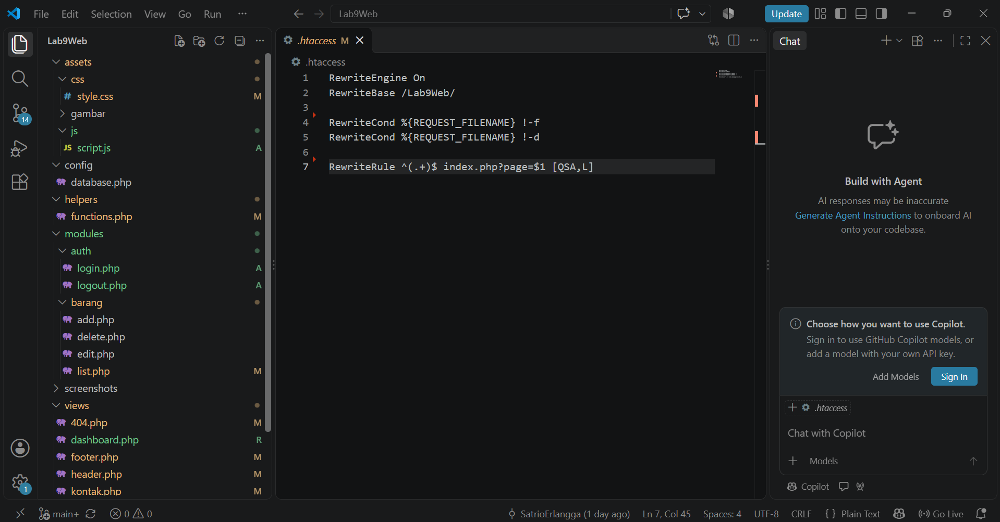

### B. Modularisasi Template Layout (Latihan 1)
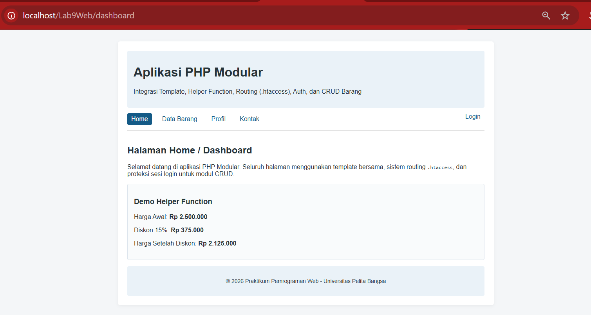
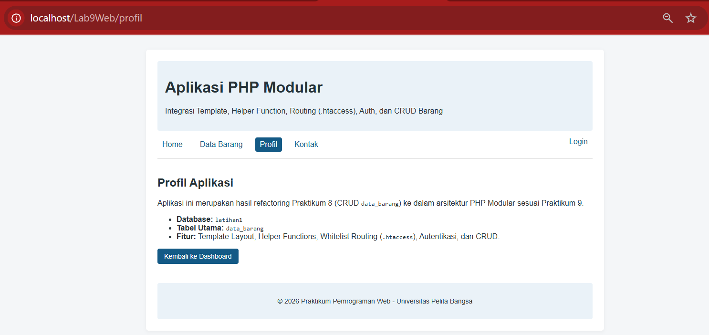

### C. Implementasi Helper Function (Latihan 2)
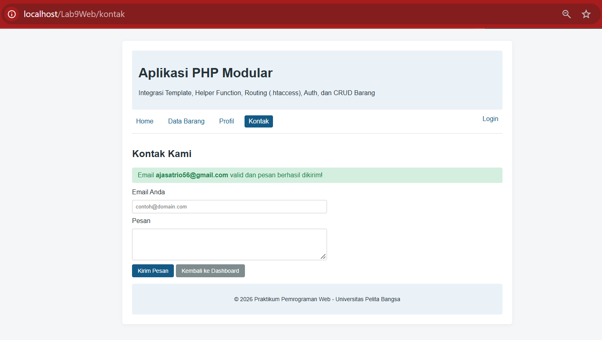

### D. Whitelist Routing & Halaman 404 (Latihan 3)
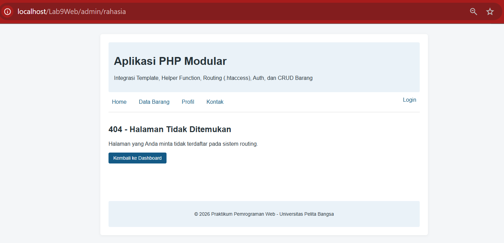

### E. Pembatasan Akses & Autentikasi (`modules/auth/`)
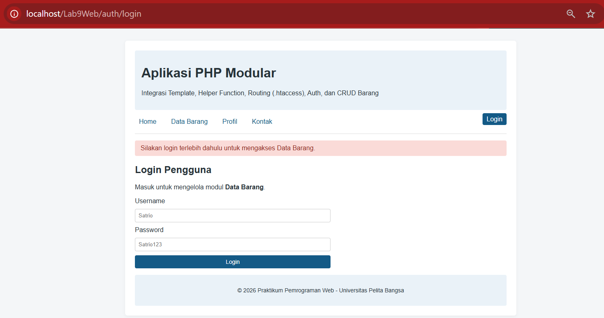

### F. Integrasi CRUD Data Barang & Interaksi JavaScript (Latihan 4)
1. **Read (Tampil Data Barang Setelah Login)**  
   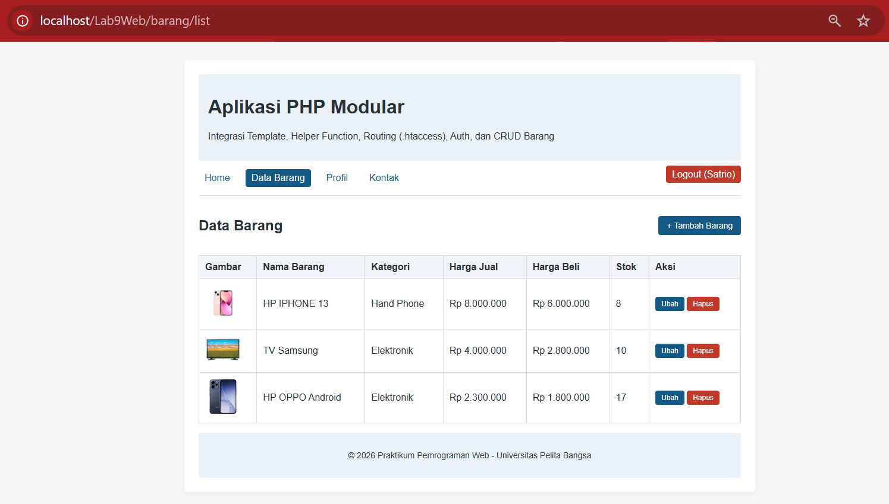

2. **Create & Preview Gambar Otomatis (`assets/js/script.js`)**  
   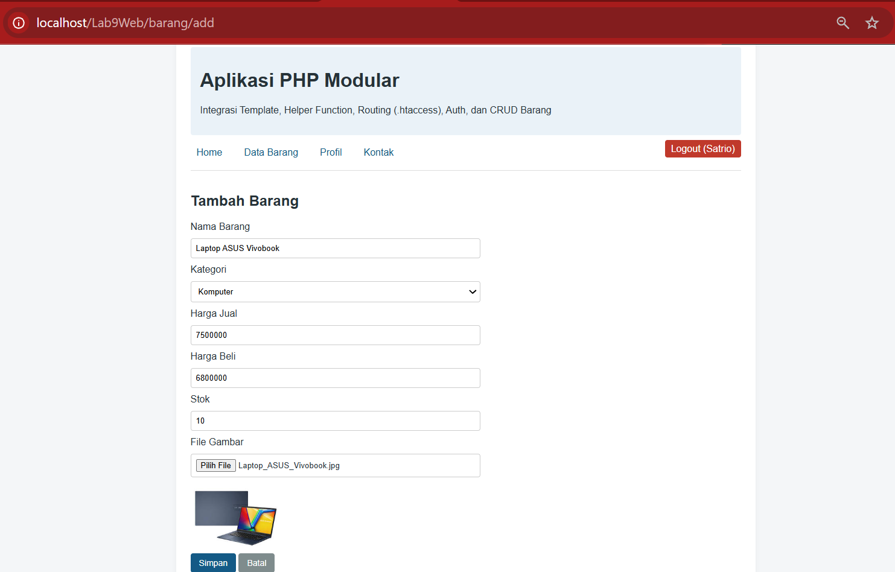

3. **Update (Ubah Data Barang)**  
   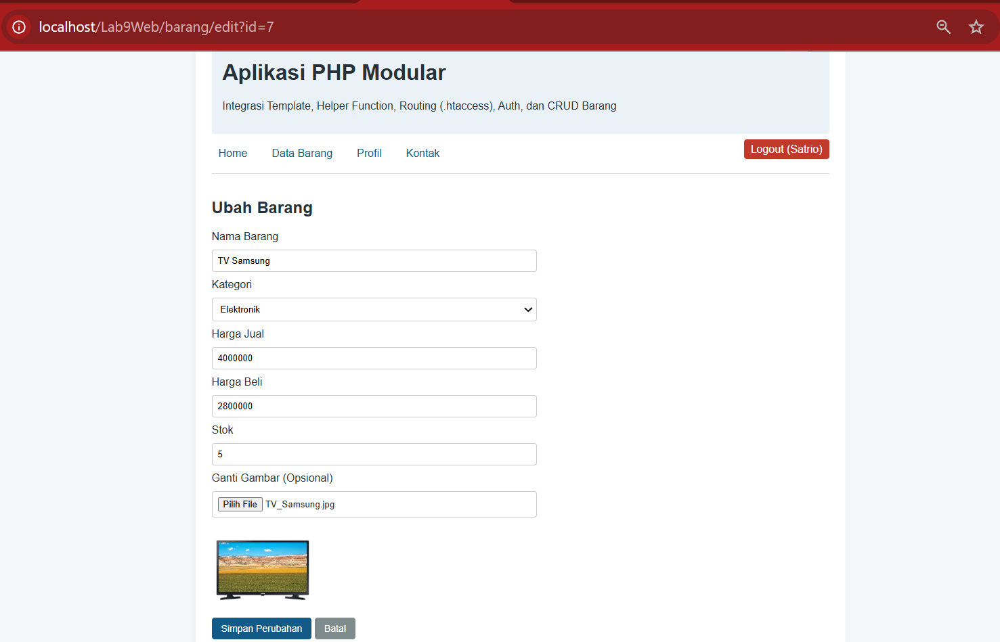

4. **Delete (Konfirmasi JavaScript & Flash Message)**  
   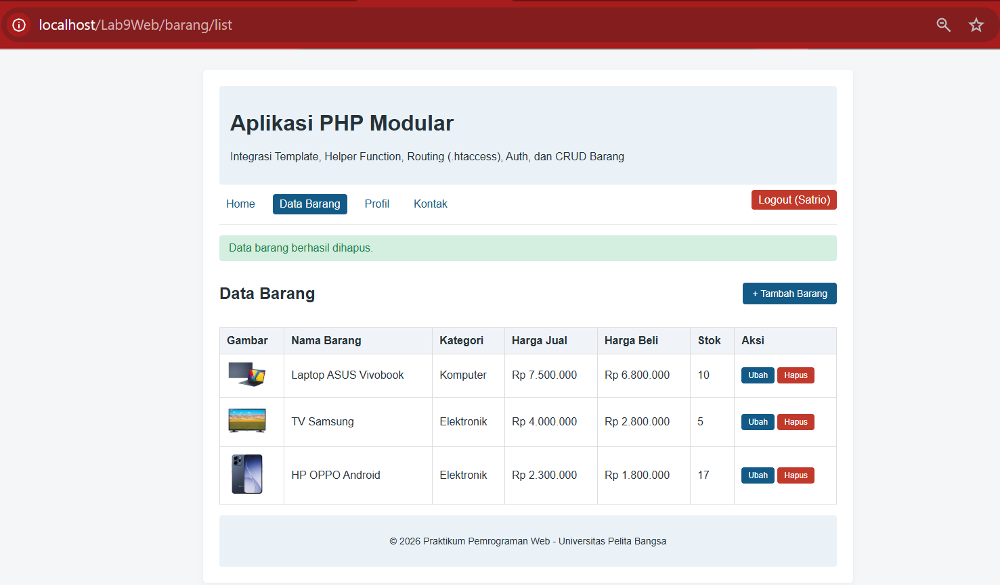

5. **Logout (`modules/auth/logout.php`)**  
   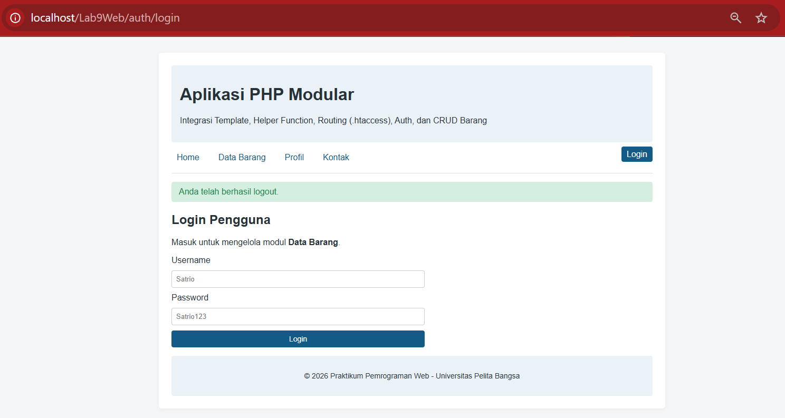

---

## 7. Kendala dan Solusi
1. **Path CSS, JavaScript, dan Gambar Tidak Terbaca pada URL Bertingkat**  
   - **Kendala:** Saat membuka `/Lab9Web/barang/list` atau `/Lab9Web/auth/login`, browser mencari file statis secara relatif di dalam sub-path tersebut.  
   - **Solusi:** Mendefinisikan konstanta `BASE_URL` (`/Lab9Web`) di `index.php` dan menggunakannya untuk semua tautan, CSS, JS, dan gambar.
2. **Error `Cannot modify header information` saat Redirect**  
   - **Kendala:** Fungsi `header('Location: ...')` pada proses login, logout, dan CRUD bisa gagal jika ada output HTML sebelumnya.  
   - **Solusi:** Mengaktifkan `ob_start()` / `ob_end_flush()` di `index.php` serta menjalankan rute non-HTML (`auth/logout`, `barang/delete`) sebelum memuat `views/header.php`.
3. **Trailing Slash pada URL**  
   - **Kendala:** Akses seperti `/Lab9Web/dashboard/` sempat dianggap tidak ada di whitelist.  
   - **Solusi:** Membersihkan parameter dengan `trim($page, '/')` sebelum pengecekan rute.

---

## 8. Jawaban Pertanyaan Pemahaman
1. **Pengertian & Manfaat Modularisasi:** Modularisasi adalah teknik memecah program menjadi bagian-bagian kecil sesuai tanggung jawabnya. Manfaatnya: kode dapat digunakan kembali (*reusable*), perubahan tampilan/konfigurasi cukup dilakukan di satu file, serta memudahkan pemeliharaan dan kerja tim.
2. **Perbedaan `include` dan `require`:** Jika file tidak ditemukan, `include` hanya menampilkan *warning* dan script tetap berjalan, sedangkan `require` menghasilkan *fatal error* dan menghentikan eksekusi program.
3. **Alasan `require_once` untuk Koneksi Database:** Koneksi database wajib tersedia agar aplikasi berjalan dan tidak boleh dimuat berulang kali dalam satu siklus eksekusi.
4. **Parameter, Argumen, dan `return`:** Parameter adalah variabel pada deklarasi function, argumen adalah nilai nyata yang dikirim saat pemanggilan, dan `return` adalah nilai hasil yang dikembalikan function ke pemanggilnya.
5. **Alasan Memisahkan Header & Footer:** Menghindari duplikasi kode HTML di banyak halaman serta menjaga konsistensi desain, navigasi, status login, dan pemanggilan aset CSS/JS.
6. **Fungsi `index.php` pada Routing:** Sebagai titik masuk tunggal (*front controller*) yang membaca parameter URL, memvalidasi rute terhadap whitelist, memeriksa sesi autentikasi, lalu merender template dan modul konten yang sesuai.
7. **Alasan Whitelist Rute:** Memastikan hanya halaman yang secara eksplisit diizinkan oleh pengembang saja yang boleh diakses.
8. **Risiko Menggabungkan Input `page` Langsung ke `require`:** Membuka celah keamanan *Path Traversal* atau *Local File Inclusion (LFI)* yang memungkinkan penyerang mengakses file sensitif di luar aplikasi.
9. **Fungsi `RewriteCond` dan `RewriteRule` di `.htaccess`:** `RewriteCond` menentukan syarat pengalihan (misalnya file/folder fisik tetap dilayani langsung), sedangkan `RewriteRule` mengatur pola pengalihan URL bersih ke `index.php?page=$1`.
10. **Pembagian Folder CRUD:** `config/` untuk koneksi database, `views/` untuk template bersama dan halaman statis, `helpers/` untuk fungsi umum lintas halaman, serta `modules/` untuk fitur per domain (`auth/` untuk login & logout, `barang/` untuk CRUD `data_barang`).
